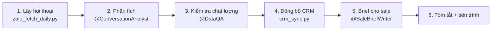

# Chạy hằng ngày: hội thoại Zalo → CRM → brief cho sale

Câu kích hoạt: “Chạy hôm nay”, “Chạy hằng ngày”, hoặc lịch tự động. `<date>` = ngày hôm nay `YYYY-MM-DD` theo giờ máy.



## 1. Lấy hội thoại

```
python3 scripts/zalo_fetch_daily.py --date <date>
```

- Mỗi OA chỉ đọc một lần (Zalo không tách hội thoại theo ứng dụng), lấy tin mới kể từ lần chạy trước. Lần đầu lấy `fetch.first_run_hours`, mặc định 48 giờ. Muốn lấy lùi xa hơn ở lần đầu: `--since-hours 168`.
- Mỗi khách được giao cho sale theo nhãn Zalo (`sale_tag`). Kết quả có `per_sale` (số khách của từng sale) và `unassigned` (số khách chưa phân công).
- Chỉ lấy khách của một sale, ví dụ khi sale hỏi “khách của tôi hôm nay”: `--app <app_id> --since-hours 24`. Lệnh này lọc theo nhãn của sale và không ảnh hưởng lần chạy hằng ngày.
- Ứng dụng đọc bị lỗi: script tự thử ứng dụng khác của cùng OA (`reader_errors`). Nếu cả OA lỗi (`ok: false`), con trỏ của OA giữ nguyên nên lần sau lấy bù. Ghi lỗi vào tóm tắt kèm việc cần làm (bảng lỗi trong `ZALO_OA_CONNECTION.md`).
- Chạy lại trong ngày an toàn: chỉ lấy tin mới hơn, gộp vào cùng thư mục ngày.

## 2. Phân tích (agent)

Đọc `outputs/01_daily_extractions/<date>/index.json`, xử lý mọi hội thoại `status = pending_analysis` theo `subagents/01_conversation_analyst.md` và skill `.claude/skills/conversation-analysis/SKILL.md`.

- Mỗi hội thoại → một tệp `analysis/<oa_id>_<user_id>.json` đúng schema `rules/data_schemas.md` §2, rồi đổi `status` trong `index.json` thành `analyzed`.
- Đọc `product-marketing.md` và `config/business.json` → `analysis` một lần đầu phiên để biết sản phẩm, nhóm khách.
- Đọc phân tích gần nhất của cùng khách (ngày trước trong `outputs/01_daily_extractions/*/analysis/`, hoặc `config/state/customers.json`) để **cập nhật** thay vì tạo lại: cơ hội đã có → `opportunity.action = "update"`; không lặp note/task đã có.
- Nhiều hội thoại (> 30): khi môi trường hỗ trợ subagent, chia lô ~15 hội thoại/subagent chạy song song, mỗi subagent nhận đường dẫn tệp và quy tắc trên. Không hỗ trợ thì xử lý tuần tự.
- Không in nội dung hội thoại ra chat. Khi cần cho người dùng xem, chỉ đưa tóm tắt.

## 3. Kiểm tra chất lượng

Theo `subagents/02_data_qa.md`, rà toàn bộ tệp phân tích trước khi đồng bộ: JSON hợp lệ, đúng giá trị cho phép, có `evidence`, số điện thoại/email xuất hiện thật trong hội thoại hoặc `zalo_profile`, task không trùng việc sale đã làm. Sửa tệp nếu sai; không chắc thì đặt `flags.needs_human_review = true`.

## 4. Đồng bộ CRM

```
python3 scripts/crm_sync.py --date <date> --dry-run     # lần đầu hoặc khi sync.auto_sync = false
python3 scripts/crm_sync.py --date <date>
```

- `sync.auto_sync = false` (mặc định): chạy `--dry-run`, trình bày bảng tóm tắt (số người/công ty/cơ hội/task/note sẽ tạo, 3–5 ví dụ), hỏi “1. Đẩy lên CRM. 2. Xem chi tiết. 3. Chưa đẩy.” Khi chạy theo lịch (không ai trả lời): chỉ `--dry-run`, ghi “chờ duyệt đồng bộ” vào tóm tắt.
- `sync.auto_sync = true`: chạy thật.
- Chưa kết nối TinaCRM (hoặc người dùng chọn “Chưa đẩy”) nhưng vẫn muốn lập chiến dịch: `python3 scripts/crm_sync.py --date <date> --index-only` chỉ cập nhật `config/state/customers.json`, không gọi CRM. `--dry-run` không ghi tệp nào.
- Hội thoại `needs_review` không được đẩy; liệt kê cho người dùng, sau khi họ quyết định thì sửa tệp phân tích và chạy `--only <conversation_key> --include-review`.
- Lỗi `failed`: đọc thông báo; 401/403 → khóa TinaCRM; lỗi trường → đối chiếu schema `<base_url>/rest/open-api/core`, sửa `field_mapping`/`stage_mapping`. Chạy lại an toàn (ledger chống trùng).

## 5. Brief cho từng sale

Theo `subagents/03_sale_brief_writer.md`: mỗi sale một tệp `outputs/03_sale_briefs/<date>/<sale-slug>.md`. Nếu đã kết nối email/Slack/Zalo nhóm và người dùng cho phép, gửi brief cho sale; nếu không, chỉ lưu tệp.

## 6. Tóm tắt và tiến trình

Tóm tắt tối đa 8 dòng:

```
Ngày <date>: <n> hội thoại mới từ <k> ứng dụng.
CRM: +<a> người, +<b> công ty, +<c> cơ hội (<d> cập nhật), +<e> task, +<f> note. Bỏ qua <g>, lỗi <h>.
Cần xem lại: <m> khách (<lý do ngắn>).
Khách chưa được trả lời > 2 giờ: <x> (sale: …).
Chưa phân công: <u> khách (cần quản lý chọn sale) | không có.
Lỗi kết nối: <ứng dụng – việc cần làm> | không có.
```

Cập nhật dòng “Lần chạy hằng ngày gần nhất” trong `config/workflow_progress.md`.

## Khi chạy theo lịch

- Không hỏi (không ai trả lời). Việc cần người dùng (cấp quyền lại Zalo, duyệt đồng bộ, khách cần xem lại, giao khách chưa phân công) → bỏ qua phần đó, ghi vào tóm tắt. Không tự gắn nhãn sale khi chạy theo lịch.
- Đã có lần chạy hoàn tất hôm nay: vẫn chạy bước 1 (chỉ lấy tin mới), phân tích phần mới, đồng bộ, cập nhật brief.
- Không gửi tin Zalo cho khách trong lần chạy hằng ngày; gửi tin chỉ thuộc chiến dịch (`CAMPAIGNS.md`).
